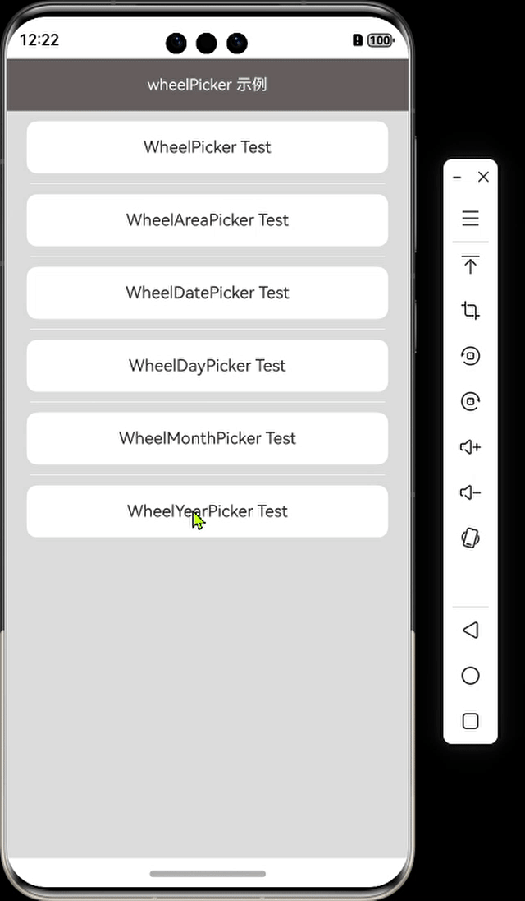
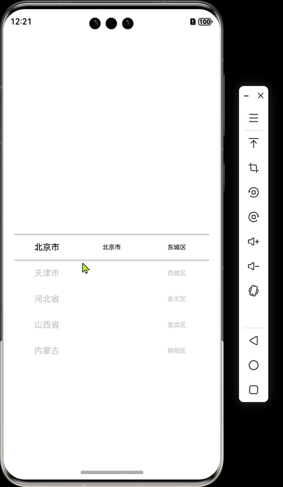
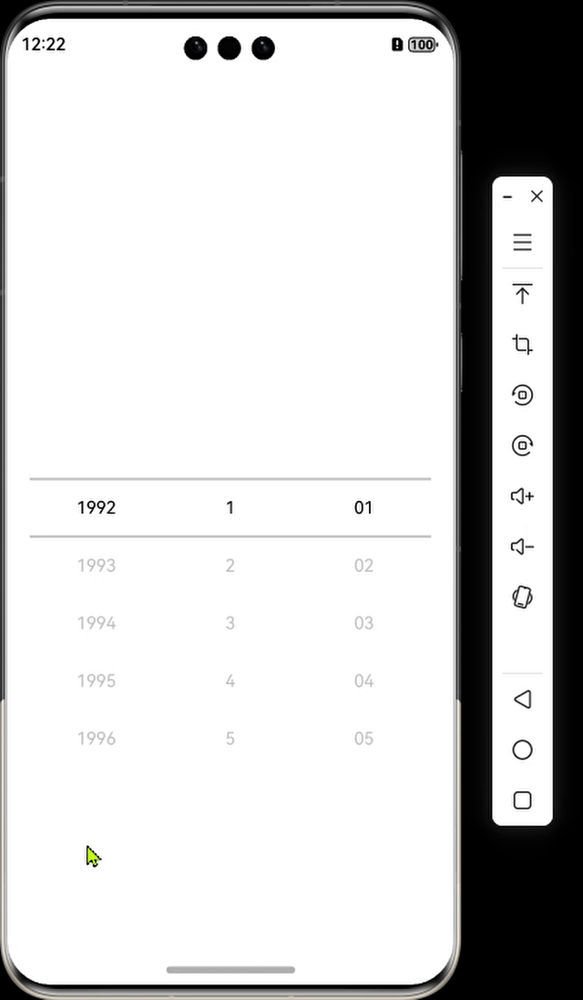
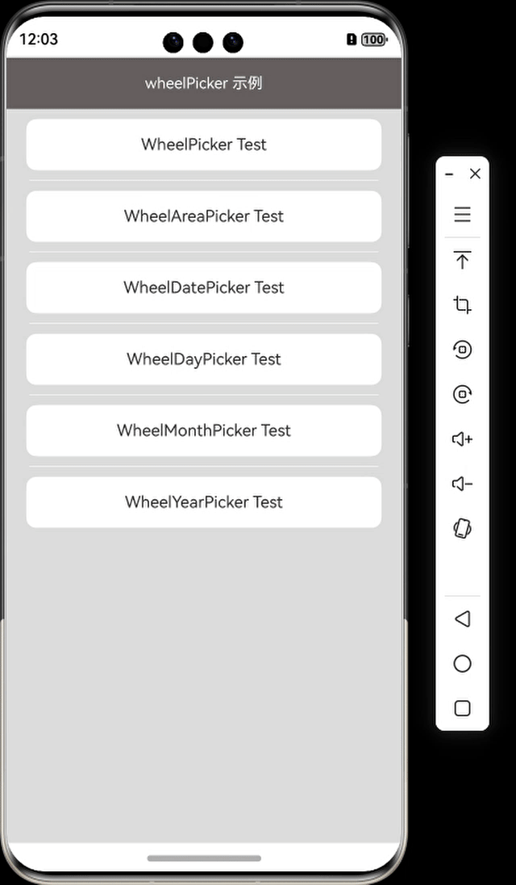

<div align="center">
<h1>wheel-picker-cj</h1>
</div>

<p align="center">


</p>

## 介绍

wheel-picker-cj 可以实现滚轮选择，可以设置多种 UI 效果，实现的选择器有：时间选择器、地区选择器的三级联动、年、月、日选择器、自定义选择器。

<p align="left">

</p>

## 特性

- 支持地区选择三级联动、日期选择器、自定义选择器、年、月、日选择器；
- 循环显示数据项；
- 设置可见数据项条数；
- 在滚轮静止状态直接获取选中数据项；
- 滚动监听获取滚轮停止后选中项以及滚动各项参数；
- 设置当前选中项文本颜色和非选中项文本颜色；
- 设置数据项之间间隔；
- 支持绘制指示器以及指定指示器颜色、尺寸；
- 支持绘制幕布以及指定幕布颜色；

### 源码目录

```shell
├─AppScope
├─doc            # API文档和使用手册存放目录                   
├─entry          # 示例代码文件夹                  
├─wheelpicker # wheelpicker 库源目录                  
│  └─src
│      └─main
│          ├─cangjie
│          │  └─src                                     
│          │      ├─constant                           # 省份、城市、地区汇总
│          │      ├─listener                           # 选择器监听事件
│          │      ├─province                           # 地区选择器数据
│          │      ├─solar_calendar                     # 日历数据
│          │      ├─wheel_area_picker_component        # 地区选择器组件
│          │      ├─wheel_area_picker_model            # 地区选择器数据配置构建类
│          │      ├─wheel_date_picker_component        # 日期选择器组件
│          │      ├─wheel_date_picker_model            # 日期选择器数据配置构建类
│          │      ├─wheel_day_picker_component         # 日选择器组件
│          │      ├─wheel_day_picker_model             # 日选择器数据配置构建类
│          │      ├─wheel_month_picker_component       # 月选择器组件
│          │      ├─wheel_month_picker_model           # 月选择器数据配置构建类
│          │      ├─wheel_picker_component             # 自定义选择器组件
│          │      ├─wheel_picker_model                 # 自定义选择器数据配置构建类
│          │      ├─wheel_year_picker_component        # 年选择器组件
│          │      ├─wheel_year_picker_model            # 年选择器数据配置构建类
│          └─resources
├─hvigor     # 构建工具目录
├─README.md  # wheel-picker-cj 介绍及使用说明
```
## 接口说明

主要类和函数接口说明详见 [API](doc/feature_api.md)

## 使用说明

1. 通过 module 引入
    1. 克隆下载项目
    2. 将 wheelpicker 模块拷贝到应用项目下
    3. 修改自身应用 entry 下的 oh-package.json5 文件，在 dependencies 字段添加 "wheelpicker": "file:../wheelpicker"
      ```json
      {
         "name": "entry",
         "version": "1.0.0",
         "description": "Please describe the basic information.",
         "main": "",
         "author": "",
         "license": "",
        "dependencies": {
            "wheelpicker": "file:../wheelpicker"
        }
      }
      ```
    4. 修改自身应用 entry/src/main/cangjie 下的 cjpm.toml 文件，在 [dependencies] 字段下添加 wheelpicker = {path = "../../../../wheelpicker/src/main/cangjie", version = "1.0.0"}
       ```toml
       [dependencies]
           wheelpicker = {path = "../../../../wheelpicker/src/main/cangjie", version = "1.0.0"}
       ```
    5. 在项目中使用 import wheelpicker.* 引用 wheelpicker 项目
       ```cangjie
       import wheelpicker.*
       ```
2. 把 wheel-picker-cj 作为三方库依赖引入
    1. 目标工程把 wheel-picker-cj 依赖库作为 git submodule 引入

    ```
    > cd $工程根目录
    > mkdir third-party
    > cd third-party
    > git submodule add "https://gitcode.com/Cangjie-TPC/wheel-picker-cj.git"
    ```
    2. 修改自身应用 entry/src/main/cangjie 下的 cjpm.toml 文件，添加依赖
    ```toml
    [dependencies]
        wheelpicker = {path = "../../../../third-party/wheel-picker-cj/wheelpicker/src/main/cangjie", version = "1.0.0"}
     ```
    3. 在项目中使用 wheelpicker 组件
       ```cangjie
       import wheelpicker.*
       ```

## 功能示例

详见 `entry`

#### 地区选择器示例

```cangjie
import wheelpicker.*

internal import ohos.base.*
internal import ohos.component.*
internal import ohos.state_manage.*
import ohos.state_macro_manage.*
import ohos.router.*

@Entry
@Component
class MyWheelAreaPicker {
    @State
    var showWheelAreaPicker: WheelAreaPickerModel = WheelAreaPickerModel()

    protected override func aboutToAppear() {
        this.showWheelAreaPicker = this.showWheelAreaPicker
        .setItemTextSize(15)
        .setTextHeight(20.0)
        .setItemAlign(HorizontalAlign.Center)
        .setIndicatorColor(Color.GRAY) //设置选中幕布上下边框颜色
        .setCurtainColor(Color.WHITE) //设置选中幕布颜色
        .setItemTextColor(Color.GRAY) // 设置数据的颜色
        .setSelectedItemTextColor(Color.BLACK) //设置选中的数据颜色
        .setScrollBgColor(Color.WHITE) // 设置滚动组件的颜色
    }

    func build() {
        Column() {
            Flex(
                FlexParams(direction: FlexDirection.Column, alignItems: ItemAlign.Center,
                justifyContent: FlexAlign.Center)
           ) {
              WheelAreaPicker(model: this.showWheelAreaPicker)
            }.width(100.percent)
        }
    }
}
```
<p align="left">

</p>

#### 日期选择器示例

```cangjie
import wheelpicker.*
internal import ohos.base.*
internal import ohos.component.*
internal import ohos.state_manage.*
import ohos.state_macro_manage.*
import ohos.router.*
import ohos.prompt_action.*
@Entry
@Component
class MyWheelDatePicker {
    @State
    var showWheelDatePicker: WheelDatePickerModel = WheelDatePickerModel()

    protected override func aboutToAppear() {
       this.showWheelDatePicker = this.showWheelDatePicker
        .setItemTextSize(15.0) //设置文本大小
        .setTextHeight(30.0)  //设置文本高度
        .setItemSpace(10.0)  //设置文本间隔
        .setItemAlignYear(HorizontalAlign.Center) //年文本居中显示
        .setItemAlignMonth(HorizontalAlign.Center) //年文本居中显示
        .setItemAlignDay(HorizontalAlign.Center) //年文本居中显示
        .setVisibleItemCount(9)  //设置显示的条数
        .setIndicatorColor(Color.GRAY) //设置选中幕布上下边框颜色
        .setIndicatorSize(2.0)  //设置选中幕布上下边框宽度
        .setCurtainColor(Color.WHITE) //设置选中幕布颜色
        .setItemTextColor(Color.GRAY) // 设置数据的颜色
        .setSelectedItemTextColor(Color.BLACK) //设置选中的数据颜色
        .setScrollBgColor(Color.WHITE) // 设置滚动组件的颜色
        .setCyclic(false) //是否开启循环
        .setYearStart(1992) //设置开始年份
        .setYearEnd(2025) //设置结束年份
    }

    func build() {
        Column() {
            Flex(FlexParams(
                    direction: FlexDirection.Column,
                    alignItems: ItemAlign.Center,
                    justifyContent: FlexAlign.Center
                )) {
                WheelDatePicker(model: this.showWheelDatePicker)
            }.width(100.percent)
        }
    }
}
```
<p align="left">

</p>

#### 自定义选择器示例

```cangjie
import wheelpicker.*

internal import ohos.base.*
internal import ohos.component.*
internal import ohos.state_manage.*
import ohos.state_macro_manage.*
import ohos.router.*
import ohos.prompt_action.*
import std.math.*
import std.random.*

@Entry
@Component
class MyWheelPicker {
    @State
    var showWheelPickerLeft: WheelPickerModel = WheelPickerModel()
    @State
    var showWheelPickerMiddle: WheelPickerModel = WheelPickerModel()
    @State
    var showWheelPickerRight: WheelPickerModel = WheelPickerModel()

    private var arr: Array<String> = [
        "AigeStudio",
        "Aige",
        "爱哥",
        "الحب  اخي",
        "jeg elsker",
        "xiBa",
        "Amor de irmão",
        "armastan",
        "愛の兄",
        "xiOngD",
        "любовь - братa",
        "miłość bracie",
        "Liebe",
        "Lamour",
        "rakastan sinua",
        "láska..",
        "dragostea.",
        "jag älskar",
        "ljubezen, brat.",
        "愛哥",
        "bieLie",
        "αγάπη μου",
        "a szerelem.",
        "Amore, fratello."
    ]

    @State
    var randomNumber: Int64 = Int64(floor(Random().nextFloat64() * Float64(this.arr.size - 1)))
    @State
    var randomSelect: String = this.arr[0]

    protected override func aboutToAppear() {
        this.randomSelect = this.arr[randomNumber]

        this.showWheelPickerLeft = this.showWheelPickerLeft
        .setItemAlign(HorizontalAlign.End)
        .setData(this.arr)
        .setCurtainColor(Color.WHITE)
        .setCyclic(true)
        .setFontFamily("")
        .setIndicatorColor(Color.RED)
        .setIndicatorSize(1.0)
        .setItemSpace(8.0)
        .setItemTextColor(Color(0x536D8A))
        .setItemTextSize(15.0)
        .setSelectedItemTextColor(Color.GREEN)
        .setTextHeight(20.0)
        .setVisibleItemCount(7)
        .setSelectDataShow({
            text: String => PromptAction.showToast(message: "Left:" + text)
        })

        this.showWheelPickerMiddle = this.showWheelPickerMiddle
        .setItemAlign(HorizontalAlign.Center)
        .setItemTextSize(15.0)
        .setData(this.arr)
        .setSelectedItemTextColor(Color.BLUE)
        .setSelectDataShow({
            text: String => PromptAction.showToast(message: "Centre:" + text);
        })

        this.showWheelPickerRight = this.showWheelPickerRight
        .setItemAlign(HorizontalAlign.Start)
        .setItemTextSize(15.0)
        .setSelectedItemTextColor(Color.GRAY)
        .setData(this.arr)
        .setSelectDataShow({
            text: String => PromptAction.showToast(message: "Right:" + text);
        })
    }

    func build() {
        Column() {
            Flex(
                FlexParams(
                    direction: FlexDirection.Column,
                    alignItems: ItemAlign.Center,
                    justifyContent: FlexAlign.Start
                )
            ) {
                Button("go to:${this.randomSelect}")
                .height(70)
                .padding(10)
                .fontSize(24)
                .margin(bottom: 10)
                .onClick({
                        =>
                        this.showWheelPickerMiddle.setSelectedItemPosition(this.randomNumber)
                        this.randomNumber = Int64(floor(Random().nextFloat64() * Float64(this.arr.size - 1)))
                        this.randomSelect = this.arr[this.randomNumber]
                 })

                Flex(FlexParams(justifyContent: FlexAlign.Center)) {
                    Row() {
                        WheelPicker(model: this.showWheelPickerLeft)
                        WheelPicker(model: this.showWheelPickerMiddle)
                        WheelPicker(model: this.showWheelPickerRight)
                    }
                }
            }.width(100.percent)
        }
    }
}

```
<p align="left">

</p>

## 约束与限制

在下述版本验证通过：

    DevEco Studio 5.0.2 Release(5.0.7.200) 
    Cangjie Support Plugin 5.0.7.100

1. 由于 `cangjieUI` 标准库未提供通用属性 `hitTestBehavior`,所以设置空气感效果后滚动选择器滚动效果失效；

## 开源协议

本项目基于 [Apache License 2.0](./LICENSE)，请自由的享受和参与开源。

## 参与贡献

欢迎给我们提交 PR，欢迎给我们提交 Issue，欢迎参与任何形式的贡献。
